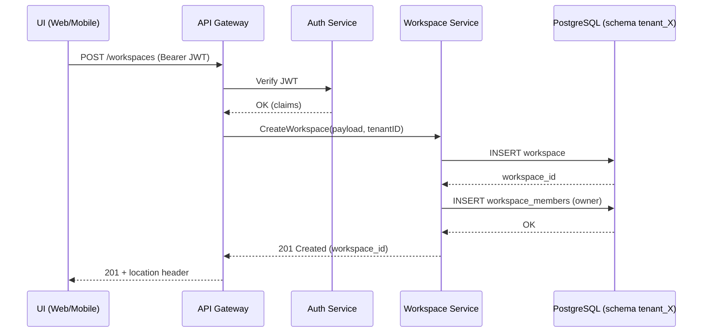

# 📦 Solución Técnica Completa – **Multitenancy y Soporte de Teams/Workspaces**  
*(para @mau16ro)*  

---  

## 1️⃣ Visión General  

Crear un sistema donde cada **Usuario** pueda pertenecer a uno o varios **Workspaces (Equipos)**, similar a Slack.  
- Cada workspace tiene su propio conjunto de recursos (canales, mensajes, archivos, configuraciones, etc.).  
- Los recursos deben estar **aislados** entre workspaces y **segregados** entre tenants (clientes/organizaciones).  
- El modelo debe ser **escalable**, **seguro**, y **flexible** para soportar:

| Característica | Requerimiento |
|----------------|---------------|
| **Multitenancy** | Aislamiento de datos por **Tenant** (empresa/organización) y por **Workspace** (equipo interno). |
| **Roles y permisos** | Administrador de Tenant, Owner de Workspace, Member, Guest. |
| **Autenticación** | SSO (OAuth2/OpenID Connect), email‑password, y “Login con” (Google, Microsoft). |
| **Autorización** | Policy‑based RBAC + Attribute‑Based Access Control (ABAC). |
| **Escalabilidad** | Horizontal scaling (micro‑servicios/K8s). |
| **Auditoría & Cumplimiento** | Logs de acceso, GDPR/CCPA. |
| **Migraciones** | Versionado de esquemas y migraciones online. |
| **Observabilidad** | Métricas, trazas y alertas. |

---  

## 2️⃣ Arquitectura de Alto Nivel  

```mermaid
graph TD
  A[Cliente (Web / Mobile)] -->|HTTPS| B[API Gateway (NGINX/Envoy)]
  B --> C[Auth Service (OAuth2 / OIDC)]
  B --> D[Tenant Router (Tenant‑ID Resolver)]
  D --> E[Workspace Service]
  D --> F[User Service]
  D --> G[Channel / Message Service]
  D --> H[File Storage Service]
  E --> I[DB (PostgreSQL + schemas per Tenant)]
  G --> J[Message Queue (Kafka / Pulsar)]
  H --> K[Object Store (S3/MinIO)]
  I --> L[Cache (Redis)]
  J --> M[Search (Elasticsearch)]
```

### Componentes Clave  

| Componente | Responsabilidad | Tecnologías sugeridas |
|------------|-----------------|-----------------------|
| **API Gateway** | Routing, rate‑limit, TLS termination, request‑id | Kong / Kong‑Enterprise, Envoy, Traefik |
| **Auth Service** | OAuth2/OIDC, MFA, JWT issuance | Keycloak, Auth0, FusionAuth |
| **Tenant Router** | Extrae `X-Tenant-ID` (header o sub‑domain) y enruta al esquema DB correspondiente | Middleware custom (Node/Go) |
| **Workspace Service** | CRUD de workspaces, membresía, roles | Go (gin), NestJS, Spring Boot |
| **User Service** | Gestión de usuarios, perfiles, enlaces a workspaces | Go / NestJS |
| **Channel/Message Service** | Canales, hilos, historial, notificaciones | Go + Kafka, Event‑sourcing |
| **File Storage** | Upload, versionado, permisos por workspace | MinIO + S3‑compatible, Cloudflare R2 |
| **DB** | Almacenamiento relacional multi‑tenant (schema per tenant) | PostgreSQL 15, pg\_partman |
| **Cache** | Tokens, sesiones, listas de miembros | Redis Cluster |
| **Search** | Indexación de mensajes, archivos | Elasticsearch 8.x |
| **Observability** | Logs, métricas, trazas | Loki + Prometheus + Grafana, OpenTelemetry |

---  

## 3️⃣ Modelo de Datos  

### 3.1 Estrategia de Multitenancy  

1. **Tenant‑Level Isolation** – Cada *Tenant* tiene su **schema** propio en PostgreSQL (`tenant_<tenant_id>`).  
2. **Workspace‑Level Isolation** – Dentro del schema, la tabla `workspaces` agrupa los recursos.  
3. **Shared‑Tables** – Algunas tablas globales (p. ej. `global_config`, `feature_flags`) permanecen en `public`.  

> **Ventajas**  
- Seguridad de datos a nivel de DB.  
- Fácil exportación/backup por tenant.  
- Posibilidad de mover un tenant a otro clúster.

> **Alternativa** (si la carga es muy alta) → *Row‑Level Security* (RLS) con `tenant_id` column.  

### 3.2 Esquema Simplificado (por tenant)

```sql
-- Dentro del schema tenant_123
CREATE TABLE tenants (
    id          UUID PRIMARY KEY,
    name        TEXT NOT NULL,
    created_at  TIMESTAMPTZ DEFAULT now()
);

CREATE TABLE workspaces (
    id          UUID PRIMARY KEY,
    tenant_id   UUID REFERENCES tenants(id) ON DELETE CASCADE,
    name        TEXT NOT NULL,
    slug        TEXT UNIQUE NOT NULL,
    created_at  TIMESTAMPTZ DEFAULT now(),
    owner_id    UUID NOT NULL, -- reference to users.id (owner)
    is_personal BOOLEAN DEFAULT FALSE,
    CONSTRAINT uq_workspace_slug UNIQUE (tenant_id, slug)
);

CREATE TABLE users (
    id          UUID PRIMARY KEY,
    email       TEXT UNIQUE NOT NULL,
    password    TEXT,
    first_name  TEXT,
    last_name   TEXT,
    created_at  TIMESTAMPTZ DEFAULT now()
);

-- Many‑to‑many: user ↔ workspace + role
CREATE TABLE workspace_members (
    workspace_id UUID REFERENCES workspaces(id) ON DELETE CASCADE,
    user_id      UUID REFERENCES users(id) ON DELETE CASCADE,
    role         TEXT CHECK (role IN ('owner','admin','member','guest')),
    joined_at    TIMESTAMPTZ DEFAULT now(),
    PRIMARY KEY (workspace_id, user_id)
);

CREATE TABLE channels (
    id           UUID PRIMARY KEY,
    workspace_id UUID REFERENCES workspaces(id) ON DELETE CASCADE,
    name         TEXT NOT NULL,
    type         TEXT CHECK (type IN ('public','private','dm')),
    created_at   TIMESTAMPTZ DEFAULT now()
);

CREATE TABLE messages (
    id           UUID PRIMARY KEY,
    channel_id   UUID REFERENCES channels(id) ON DELETE CASCADE,
    sender_id    UUID REFERENCES users(id),
    body         TEXT,
    created_at   TIMESTAMPTZ DEFAULT now(),
    edited_at    TIMESTAMPTZ,
    thread_id    UUID,  -- nullable for threading
    CONSTRAINT fk_thread FOREIGN KEY (thread_id) REFERENCES messages(id)
);
```

### 3.3 Índices críticos  

- `workspace_members (user_id, workspace_id)` – búsqueda rápida de workspaces por usuario.  
- `messages (channel_id, created_at DESC)` – carga de historial.  
- `channels (workspace_id, name)` – validación de nombres únicos por workspace.  

---  

## 4️⃣ API Design  

### 4.1 Convenciones  

- **REST + JSON** para la mayoría de recursos.  
- **WebSocket / Server‑Sent Events** para mensajes en tiempo real.  
- **Versionado**: `/api/v1/…`  
- **Tenant Identification**:  
  - Preferencia a sub‑domain: `tenant123.myapp.com` → extrae `tenant_id` del DNS.  
  - Alternativa: Header `X-Tenant-ID` o query param `tenant`.  

### 4.2 Endpoints Principales  

| Método | Ruta | Descripción | Roles requeridos |
|--------|------|-------------|------------------|
| `POST` | `/api/v1/workspaces` | Crear workspace (personal o de equipo) | Authenticated |
| `GET`  | `/api/v1/workspaces` | Listar workspaces del usuario | Authenticated |
| `GET`  | `/api/v1/workspaces/{ws_id}` | Detalle del workspace | Member/Guest |
| `PATCH`| `/api/v1/workspaces/{ws_id}` | Editar nombre, owner, etc. | Owner/Admin |
| `DELETE`| `/api/v1/workspaces/{ws_id}` | Eliminar (soft‑delete) | Owner |
| `POST` | `/api/v1/workspaces/{ws_id}/members` | Invitar usuario (email) | Owner/Admin |
| `DELETE`| `/api/v1/workspaces/{ws_id}/members/{user_id}` | Remover miembro | Owner/Admin |
| `POST` | `/api/v1/workspaces/{ws_id}/channels` | Crear canal | Owner/Admin/Member (según política) |
| `GET`  | `/api/v1/channels/{channel_id}/messages` | Historial | Member/Guest |
| `POST` | `/api/v1/channels/{channel_id}/messages` | Enviar mensaje | Member/Guest |
| `PUT`  | `/api/v1/messages/{msg_id}` | Editar mensaje | Sender |
| `DELETE`| `/api/v1/messages/{msg_id}` | Borrar mensaje (soft) | Sender/Admin |
| `GET`  | `/api/v1/users/me` | Perfil propio | Authenticated |
| `GET`  | `/api/v1/users/{user_id}/workspaces` | Workspaces a los que pertenece | Authenticated (self or admin) |

### 4️⃣ Autenticación y Tokens  

- **JWT** con claims:  
  ```json
  {
    "sub": "<user_uuid>",
    "tid": "<tenant_uuid>",
    "ws": ["<workspace_uuid>", "..."],   // optional (list of active workspaces)
    "role": "member",
    "exp": 173...,
    "iat": 172...
  }
  ```
- **Refresh Tokens** almacenados en HttpOnly secure cookies.  
- **Key rotation** cada 30 días.  

### 4️⃣1 Middleware de Validación  

```go
func TenantResolver(next http.Handler) http.Handler {
    return http.HandlerFunc(func(w http.ResponseWriter, r *http.Request) {
        tenantID := extractTenantID(r) // subdomain / header
        if tenantID == "" {
            http.Error(w, "Tenant missing", http.StatusBadRequest); return
        }
        ctx := context.WithValue(r.Context(), "tenantID", tenantID)
        next.ServeHTTP(w, r.WithContext(ctx))
    })
}
```

### 4️⃣2 RBAC/ABAC  

- **Roles**: `tenant_admin`, `workspace_owner`, `workspace_admin`, `workspace_member`, `workspace_guest`.  
- **Políticas** definidas en JSON/YAML, cargadas en OPA (Open Policy Agent) o en código.  

Ejemplo OPA:

```rego
package app.authz

allow {
    input.method = "GET"
    input.path = ["api","v1","workspaces", ws_id]
    isMember(ws_id)
}
allow {
    input.method = "POST"
    input.path = ["api","v1","workspaces", ws_id, "channels"]
    hasRole(ws_id, "owner") or hasRole(ws_id, "admin")
}
```

---  

## 5️⃣ Flujo de Creación de Workspace  



- **Transacciones**: Se envuelven en una única transacción DB (workspace + owner member).  
- **Rollback** automático si alguna inserción falla.  

---  

## 6️⃣ Estrategia de Escalado  

| Capa | Técnica de Escalado | Detalles |
|------|----------------------|----------|
| **API Gateway** | Horizontal (K8s replicaSet) | Autoscaling basada en CPU/latencia. |
| **Auth Service** | Stateless, replicas + shared Redis for session revocation. |
| **Workspace Service** | Stateless, *sharding* por `tenant_id` (hash → pod). |
| **DB** | **Schema per tenant** → puede mover tenants “pesados” a clústers dedicados.<br>**Read replicas** para consultas de historial.<br>**Connection pool** por tenant. |
| **Message Queue** | Kafka partitions = `tenant_id % N` para mantener orden dentro de cada tenant. |
| **Search** | Elasticsearch index per tenant (`tenant_<id>`) o **routing** por tenant field. |
| **Cache** | Redis Cluster, TTL para listas de miembros, tokens revocados, etc. |
| **File Store** | Bucket per tenant (`tenant-<id>-files/`) con políticas IAM. |

---  

## 7️⃣ Seguridad y Cumplimiento  

1. **Cifrado**  
   - En tránsito: TLS 1.3 en todos los puntos.  
   - En reposo: PostgreSQL `pgcrypto` + Transparent Data Encryption (AWS RDS).  
   - Archivos: S3‑side encryption (AES‑256) + bucket policies por tenant.  

2. **Principio de Mínimo Privilegio**  
   - Cada micro‑servicio tiene su propio IAM role con acceso limitado a recursos.  

3. **Auditoría**  
   - **Audit log table** (`audit_logs`) con `tenant_id`, `